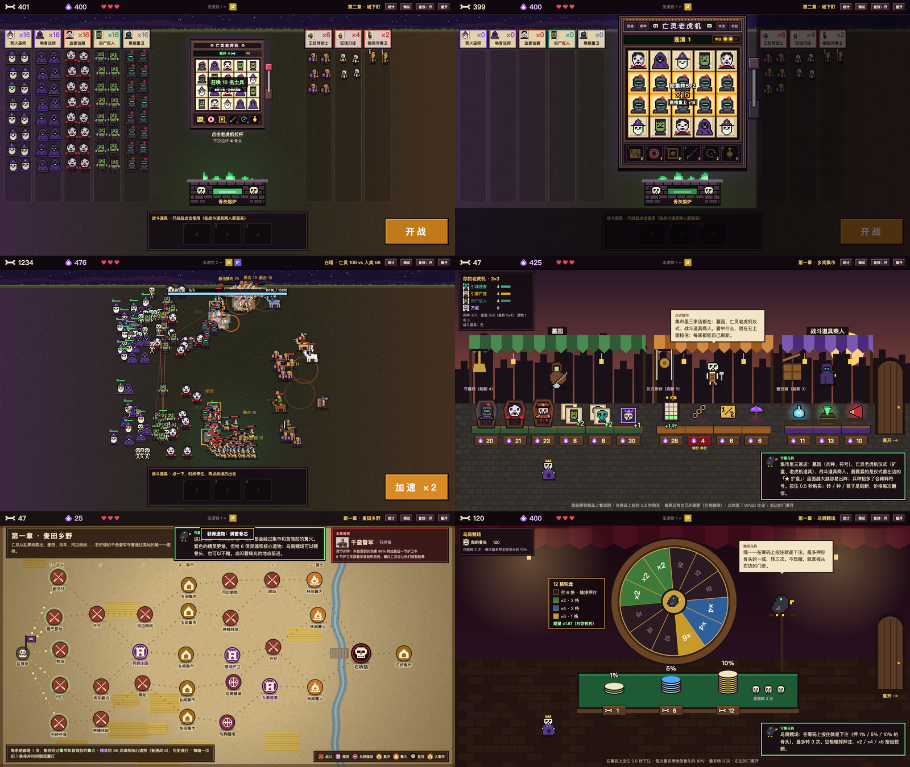

# 亡灵老虎机 · 美术交接包（v3.1 原型）

**用骨头拉一台「亡灵老虎机」召唤亡灵军团，军团自动和人类军队打仗；赢了拿遗物、去集市把老虎机越做越大，从乱葬岗一路打进白冠王都。**

这个仓库是给**美术（或做美术的 AI）**用的完整交接包：可玩的 HTML 原型 + 把所有玩法、算法、机制、模块、界面布局写清楚的文档 + 每一样需要美术的资产清单 + 51 张场景截图 + 现有占位图 + 从原型导出的全部数据。现在原型里的图全是程序画的占位，目标是**整体换成正式美术**。



## 怎么玩原型

下载仓库，双击 [`prototype/index.html`](prototype/index.html)（Chrome / Edge / Safari 都行，单文件，不用联网、不用安装）。

- 鼠标为主：点老虎机放大 → 点拉杆（或空格）→ 点「开战」看自动战斗。
- B = 阵型图鉴 · 1–6 = 老虎机道具 · 1–3 = 战斗道具（时间停止后点战场扔出去）· 商店里 WASD 走动、在商品上按住 0.5 秒购买 · F = 全屏。
- 右上角「调试」可以跳到任意节点、加兵种 / 遗物 / 道具，方便看每个场景。

## 阅读顺序（给美术 AI）

1. **[docs/02_美术资产清单.md](docs/02_美术资产清单.md)**：要做的每一样东西（321 项，P0 核心 153 项）——是什么、在哪出现、现有占位、显示尺寸、状态与动画、优先级。机器可读版：[`assets/manifest.json`](assets/manifest.json)。
2. **[docs/03_美术风格与接入规范.md](docs/03_美术风格与接入规范.md)**：硬约束（敌人是人类不是动物、兵种主色、显示尺寸、锚点朝向、背景不抢信息、动画时长）、风格建议、交付格式与命名、怎么接进原型、自检清单、给图像生成 AI 的分层提示词模板。
3. **[assets/screenshots/](assets/screenshots/README.md)**：51 张场景截图（标题、开局、老虎机各状态、战斗、四个首领、结算、三章地图、集市、篝火、赌场、各种弹窗、结局）。
4. **[docs/01_游戏完整设计文档.md](docs/01_游戏完整设计文档.md)**：完整玩法与算法（经济公式、老虎机判定 / 连锁 / 幸运灯、14 种道具、自动战斗的属性模型 / 每帧流程 / 走位 AI / 伤害管线、兵种与首领、敌军预算与心流、地图生成、集市 / 篝火 / 赌场、遗物、时间倒流、校准数据、**每个场景的坐标布局**、代码模块地图、数据结构）。
5. **[docs/04_数据附表.md](docs/04_数据附表.md)**：兵种、遗物 94、敌军 76、特性 53、章节遭遇、阵型、道具、店主台词、引导文案。

## 目录

```
README.md
prototype/index.html          可玩原型（v3.1，单文件）
docs/
  01_游戏完整设计文档.md        玩法 / 算法 / 机制 / 模块 / 布局
  02_美术资产清单.md            每一样要做的美术
  03_美术风格与接入规范.md      风格、尺寸、命名、接入、提示词
  04_数据附表.md                数据表（人看的版本）
  附录/                         原始设计稿与历次验收记录（历史，以 01–04 为准）
data/*.json                    从原型导出的数据（兵种、遗物、敌人、特性、章节、阵型、道具、商店、常量、色板、像素图源）
assets/
  manifest.json                资产清单（机器可读，321 项）
  screenshots/                 51 张场景截图 + 索引
  current/                     现有占位图（157 张单图）：units、unit_symbols、enemies、items、battle_items、map_icons、keepers、ui、backgrounds
  总览_*.png                   带名字的占位图总览（兵种、符号、敌军、道具、地图节点、店主与图标）
  cover.png                    本页的截图拼图
```

## 关键事实速查

| | |
|---|---|
| 舞台 | 1600×900 固定，按窗口等比缩放；像素图 nearest-neighbor 放大 |
| 我方 | 12 种亡灵兵种（每种一个主色）+ 召唤物白骨仆从；每种要「战场形象（带动画）」+「老虎机符号」 |
| 敌方 | 76 种**人类**（民兵 → 步兵 → 精锐 → 重装 → 首领）；id 沿用了原资料的动物编号，但画的是人 |
| 场景 | 标题 · 准备阶段（老虎机 + 双方 5 列 + 熔炉）· 自动战斗 · 三章地图 · 集市（三家店）· 篝火 · 乌鸦赌场 · 结算 / 结局 |
| 字体 | PingFang SC，6 档字号 12 / 14 / 16 / 20 / 24 / 32（文字都由程序渲染，不需要美术） |

## 说明

- 原型的兵种、遗物和敌军特性改编自游戏《How Many Dudes》的公开资料（数据里保留了原始 id 和部分原名，敌人 id 是原作的动物编号）；首领、地图、商店、老虎机系统和数值是本作原创。原作的研究资料、参考截图和视频没有放进这个仓库。
- 原型是 Game Jam 阶段的产物，还有待定的平衡问题（见 01 号文档 §17），不影响美术制作。
